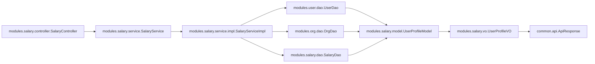

# mvc-classic-package-split

**单 Maven 模块 + 按业务域分包** 的结构示例（不是 Maven 多模块）：同一个 `src/main/java` 下，`modules/{user,org,salary}` 各自拥有 `controller/service/dao/entity/model/vo`，`common`、`config`、根级 `controller/common` 与 `modules` 平级。重点说明按业务域分包下各包的功能职责与约束。

> 仍然只有 1 个 `pom.xml`、1 个 `target/`、1 个 jar：没有子模块，没有 Maven Reactor，没有跨模块 `api` 契约包，也没有引入 ArchUnit。

## 1. 项目定位

- 演示"按业务域分包"的组织方式：把按技术层分包的 `controller/service/dao/entity/model/vo` 移动到 `modules/<domain>/` 下。
- 业务场景仅用于演示：用户-部门-薪资的只读查询。
- 重点说明各包的功能职责与约束，而不是具体业务实现。

## 2. 技术栈与运行前提

| 项 | 版本/说明 |
|---|---|
| JDK | 17 |
| Maven | 3.9.x |
| Spring Boot | 3.4.2 |
| Web | `spring-boot-starter-web`（内嵌 Tomcat） |
| 测试 | `spring-boot-starter-test` + `maven-surefire-plugin 3.5.4` |
| Lombok | 1.18.36 |
| 数据库 | 无；DAO 用 `ConcurrentHashMap` 内存实现 |
| 端口 | `18082` |

运行前提：

- **命令行构建/运行**：JDK 17 + Maven 3.9 即可，Lombok 在编译 classpath 完成注解处理。
- **IDE 内编辑**：需安装 Lombok 插件并启用 annotation processing，否则编辑器会标红 getter/构造器。

## 3. 目录结构与包职责

```text
mvc-classic-package-split/
├── pom.xml
├── README.md
└── src
    ├── main
    │   ├── java/com/example/structure/packagesplit/
    │   │   ├── PackageSplitApplication.java   # 启动类：根包全包扫描
    │   │   ├── common/                         # 公共基础包：不归属任何业务域，供各域复用
    │   │   │   ├── api/                        # 统一响应包装：HTTP 外层信封，隔离 controller 返回格式
    │   │   │   ├── constant/                   # 错误码常量：业务码与 HTTP 状态映射
    │   │   │   └── exception/                  # 业务异常：携带错误码，交由全局异常处理
    │   │   ├── config/                         # 全局基础设施：异常处理等横切能力，不放业务逻辑
    │   │   └── modules/                        # 按业务域分包：每个域内自带分层
    │   │       ├── common/                     # 通用域：系统级入口，不属于具体业务域
    │   │       │   └── controller/             # HTTP 入参绑定/路由：只调用 service，不 import dao
    │   │       ├── user/                       # 用户域：controller/service/dao/entity/vo
    │   │       ├── org/                        # 部门域：controller/service/dao/entity/model/vo
    │   │       └── salary/                     # 薪资域：controller/service/dao/entity/model/vo
    │   └── resources/                          # 应用配置：端口、应用名等运行参数
    └── test/java/.../                          # 测试包：MockMvc 验证 HTTP 契约
```

各域内包的通用职责与约束（首次出现处给出）：

- `controller/`：HTTP 入参绑定/路由，只调用 service，不 import dao，不写业务编排。
- `service/`：用例接口 + impl；impl 校验、编排本域 DAO、组装 VO/model，不直接暴露 entity。
- `dao/`：存储访问边界，只做数据存取，不写业务规则；真实项目由 Mapper 实现。
- `entity/`：持久化行对象，字段与表结构一致，不做业务裁剪。
- `model/`：service 层聚合模型，跨表/跨 DAO 组合的中间形态，不直接对外（org 与 salary 域有，user 与 common 域无）。
- `vo/`：HTTP 响应对象，按用例裁剪暴露字段，提供 `from(...)` 映射。

跨域引用现状：`modules.salary` 域直接 import `modules.user`、`modules.org` 的 DAO 与 entity；包名不提供编译期边界，按域分包只改变**归属**，不改变**依赖方向**。`modules.common` 仅承载系统级入口，不被业务域依赖。

## 4. 请求链路（`GET /api/users/1/profile`）



1. `SalaryController` 绑定 `id`，调用 `SalaryService.profile(id)`；
2. `SalaryServiceImpl` 依次调用 **user / org / salary** 三个域的 DAO（任意一步未命中抛 `BizException`，40401/40402/40403）；
3. 组装 `UserProfileModel`（含 `User`、`Org` 两个 entity）；
4. `UserProfileVO.from(model)` 裁剪为 `user{id,name} + org{id,name} + salary`（`org` 复用 `OrgVO`）；
5. `ApiResponse.ok(vo)` 包装为统一响应。

## 5. 优缺点与适用场景

**优点**

- 域内聚：改一个业务域时，controller/service/dao/entity/vo 都在同一目录树下，导航与局部改动清晰。
- 归属直观：新人按业务找代码比按"层"找更贴近需求；`modules` 下每个子包即一个可命名的域。
- 迁移成本低：业务代码零改动，仅包路径变化，便于直接对比两种组织方式。

**缺点**

- **包名不提供编译期边界**：`modules.salary` 可以随手 import `modules.user.dao`（本示例就是这样），没有模块系统帮你拦截。
- **跨域重构仍会牵连**：`salary` 依赖 `user/org` 的 DAO 与 entity，改 `User` 字段会波及 `salary`；包结构调整 ≠ 解耦。
- 域与域之间的"公共部分"容易回流到根级 `common`，久而久之 `common` 变成新的"上帝包"。

**适用场景**：中小单体、业务域已能叫出名字但还不需要拆 Maven 模块的团队；作为从"按层分包"到"多模块/微服务"的中间形态。

## 6. 运行 / 测试 / curl（从仓库根执行）

```powershell
cd mvc-classic-package-split

# 构建 + 冒烟测试（MockMvc，8 个用例，不占端口）
mvn -q clean verify

# 启动（默认 18082；端口冲突用参数覆盖）
mvn spring-boot:run
# 或：mvn spring-boot:run -Dspring-boot.run.arguments=--server.port=其他端口
# 或：java -jar target/mvc-classic-package-split-1.0.0-SNAPSHOT.jar
```

另开终端（Windows 控制台 GBK，中文参数用 percent-encoded）：

```powershell
curl.exe "http://localhost:18082/api/hello?name=%E5%BC%A0%E4%B8%89"
# {"code":0,"message":"ok","data":"Hello, 张三"}

curl.exe "http://localhost:18082/api/users/1"
# {"code":0,"message":"ok","data":{"id":1,"name":"张三","orgId":1}}

curl.exe "http://localhost:18082/api/users/1/profile"
# {"code":0,"message":"ok","data":{"user":{"id":1,"name":"张三"},"org":{"id":1,"name":"开发部"},"salary":10000}}

curl.exe "http://localhost:18082/api/users/2/profile"
# {"code":0,"message":"ok","data":{"user":{"id":2,"name":"李四"},"org":{"id":2,"name":"测试部"},"salary":8000}}

curl.exe "http://localhost:18082/api/orgs/tree"
# {"code":0,"message":"ok","data":[{"id":1,"name":"开发部","children":[]},{"id":2,"name":"测试部","children":[]}]}

curl.exe -i "http://localhost:18082/api/users/999"   # 404 {"code":40401,"message":"用户不存在: 999","data":null}
curl.exe -i "http://localhost:18082/api/users/abc"   # 400 {"code":40001,...}
```

## 7. mock 数据与重置

| 表 | 数据 |
|---|---|
| `org` | `1 开发部 parentId=null`、`2 测试部 parentId=null` |
| `user` | `1 张三 orgId=1`、`2 李四 orgId=2` |
| `salary_record` | `1 → 10000`、`2 → 8000`（单位：元） |

数据写在 `modules/*/dao/mem/InMemory*Dao` 构造器中，进程启动时写入 `ConcurrentHashMap`，**重启即重置**。

错误码：`40001`(400) 参数类型错误、`40401`(404) 用户不存在、`40402`(404) 部门不存在、`40403`(404) 薪资记录不存在、`50001`(500) 部门树结构非法、`50000`(500) 内部错误。

## 8. 停止服务

- 前台 `mvn spring-boot:run` 或 `java -jar` 时按 `Ctrl+C`；
- 停止后确认端口已释放（应无输出）：

```powershell
netstat -ano | findstr ":18082" | findstr "LISTENING"
# 或
Get-NetTCPConnection -LocalPort 18082 -State Listen -ErrorAction SilentlyContinue
```